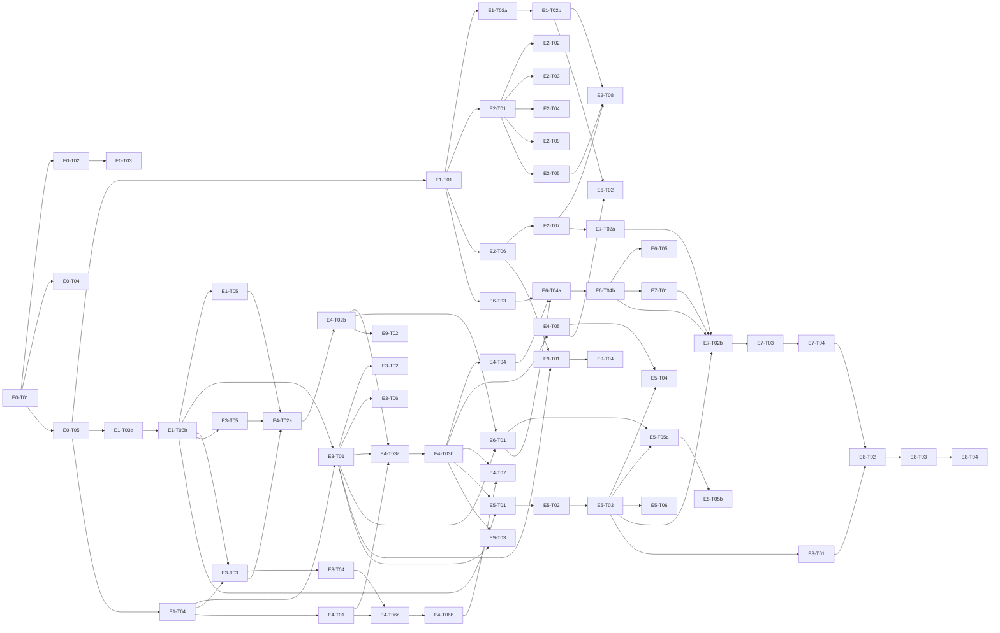

# 00 — regimekit: build order, dependency graph and conventions

| Field | Value |
|---|---|
| Ticket ID | E-OV (meta ticket, read once, never "done") |
| Source of truth | `regimekit_concept.md` v1.1 = Part I v1.0 (2026-09-04, "Approved for ticket derivation") with the Part II §15.7 amendments applied. Part II itself (`extensions.md`, draft 1.1) is **not** a ticket source until `v0.1.0` ships. |
| Derived | 2026-09-05 |
| Amended | 2026-09-14 — Part II §15.7 amendments folded into 20 tickets (see §8); no ticket added or removed |
| Ticket count | 63 implementable tickets in 10 epics (E0–E9); concept L-tickets split into a/b |

## 1. Purpose

Every ticket in this set is written to be implementable with **only its own file plus this overview** open. Each ticket embeds the formulas, shapes and interface signatures it needs under *Context (self-contained)*; the `Concept refs` row tells the implementer where to look if something is ambiguous. The concept document remains authoritative: if a ticket and the concept disagree, the concept wins and the ticket is fixed.

## 2. ID scheme

- Concept ticket IDs (`E4-T03`) are preserved so traceability (concept §7.4) still holds.
- Concept tickets sized **L** were split into sub-tickets suffixed `a`, `b` (e.g. `E4-T03a`, `E4-T03b`). The sub-tickets together satisfy the parent's acceptance criteria; the parent ID is not a ticket of its own.
- Tests are named after the ticket: `tests/<layer>/test_e4_t03a_*.py`. PR title = `E4-T03a: <title>`. Branch = `feat/E4-T03a-short-slug`.

## 3. Ticket template (all tickets use this)

```
# <ID> — <Title>
| Size | S (≤1 d) / M (1–3 d) / L (3–5 d) |   | Requirements | FR-…, NFR-… |   | Milestone | M0…M6 |   | Concept refs | §… |
## Goal                   one sentence
## Context (self-contained)   everything needed to implement without opening the concept
## Creates                files / modules / tests / docs touched
## Acceptance criteria    testable, numbered
## Tests                  what the ticket's tests must cover (part of the ticket, never separate)
## Out of scope           explicit exclusions
## Connections            Depends on / Blocks / Relates to
```

## 4. Global conventions (apply to every ticket; restated here so tickets stay short)

### 4.1 Stack (pin in `uv.lock`)
Python ≥ 3.13 · `jax`/`jaxlib` ≥ 0.11 (x64 on) · `equinox` ≥ 0.13 · `optax` ≥ 0.2.8 · `numpy` ≥ 2.1 · `pandas` 2.x · `pyarrow` ≥ 25 · `pydantic` ≥ 2.13 (`extra="forbid"`) · `ruamel.yaml` · `typer` · `structlog` · `jaxtyping` + `beartype`. Dev: `pytest` ≥ 9, `pytest-cov`, `pytest-xdist`, `pytest-benchmark`, `hypothesis`, `ruff` ≥ 0.16, `mypy` ≥ 2.1 (strict, pydantic plugin), `scipy` (tests only), `mkdocs-material`, `mkdocstrings[python]`. Extras: `gpu`, `providers`, `mcmc` (the Part II extras `finance`, `plot`, `sklearn`, `bayes` are **not** added in 0.1.0). **No new runtime dependency without an ADR.**

### 4.2 Package layout (src layout, `src/regimekit/`)
`config/` (schema, yaml_io, defaults, migrate) · `data/` (contracts, cache, calendar, prepare, transforms, quality — domain-neutral) · `finance/` (the finance *profile*: `providers/` in 0.1.0; grows in Part II) · `model/` (spec, params, dists, emission/, duration/, transition, covariates, lattice) · `statespace/` (index, builders, transitions) · `engine/` (base, expanded_hmm, explicit_duration, viterbi) · `estimation/` (objective, optimizers, init, map, report, results) · `inference/` (decode, simulate, forecast, covariate_forecasters) · `evaluation/` (metrics/, backtest, strategies, compare) · `persistence/` (store, results) · `cli/app.py` · `project.py` · `utils/` (jax_setup, rng, logging, errors, typing). Tests: `tests/{reference,unit,property,golden,recovery,integration,benchmark,fixtures}`. Docs: `docs/{guide,math,api,adr}`.

### 4.3 Layer rule (FR-D07)
`model/`, `statespace/`, `engine/`, `estimation/`, `inference/` MUST NOT import anything from `regimekit.data` except `regimekit.data.contracts`. They contain no I/O, no logging inside jitted code, no network. I/O lives in `data/`, `persistence/`, `cli/`, `project.py`. A static test (E1-T01) enforces this.

**Profile rule (Part II §15.7, ADR-0012):** `regimekit.finance` sits *on top of* the core and may import any core package. No core package (`config, data, model, statespace, engine, estimation, inference, evaluation, persistence`) may import `regimekit.finance`; only `cli/` and `project.py` may. The same E1-T01 static test enforces this.

### 4.4 Errors
`RegimekitError → ConfigError, DataError, ProviderError, NumericalError, PersistenceError` in `utils/errors.py`. Messages include the config path (`model.duration.r[2]`) or array name. No NaN/Inf leaves a public function (guard → `NumericalError`). CLI exit codes: 0 ok · 2 config · 3 data · 4 numerical · 5 provider.

### 4.5 JAX conventions
1. `regimekit.utils.jax_setup` enables x64 at import and selects the device; disabled x64 → `NumericalError`.
2. JIT boundaries only: `engine.loglik`, `engine.forward_backward`, `engine.viterbi`, `estimation.objective.value_and_grad`, `inference.simulate.simulate_paths`. Everything else composes these in plain Python.
3. Static (shape-defining): `N, S, r_i, order, d_max, T`. Dynamic: parameters, data, covariates. `StateSpace` is rebuilt once per fit.
4. Recursions via `jax.lax.scan`; `A_t` built inside the scan body; never materialize `(T, S, S)`.
5. Everything in log space; `logsumexp`; `-inf` for structural zeros, masked with `jnp.where` before `exp`.
6. RNG: `key = jax.random.key(seed)`; `key_for(seed, *ids)` folds ids in; no global RNG; NumPy RNG only in the data-layer bootstrap.
7. No Python control flow on traced values; branch on config, not data. Masked observations contribute 0 log-density.
8. Explicit-duration engine may hold `(T, N, D_max)` if `T·N·D_max ≤ 5e7`, else chunked scan.

### 4.6 Coding standards
`mypy --strict` on `src/`; arrays annotated with `jaxtyping` (`Float[Array, "T N"]`); public numerical functions decorated `@jaxtyped(typechecker=beartype)`, active when `REGIMEKIT_TYPECHECK=1` (set in tests). Google docstrings with the math-symbol mapping (`sigma ↔ σ_i`) and shapes. Math-faithful names: `log_alpha`, `jump_probs`, `advance_prob`, `n_states`, `n_expanded`, `d_max`, `n_sim`. Contracts are frozen dataclasses or `eqx.Module`s (pytrees). Ruff: line length 110, rules `E F W I N UP B SIM PT RUF D ANN NPY`, pydocstyle google.

### 4.7 Testing
TDD is mandatory for `dists`, `params`, `statespace`, `engine`, `estimation.objective`, `inference.forecast` aggregation, `evaluation.metrics`, `data.prepare/calendar/cache` (tests first). Markers: `slow`, `live`, `benchmark`, `gpu`. Coverage ≥ 90 % global, ≥ 85 % per package (`model, engine, estimation, inference, data, evaluation`). Golden tests compare JAX against `tests/reference/` NumPy code.

**Numerical tolerances (concept Appendix D)** — quote these in tests, do not invent others:

| Check | Tolerance |
|---|---|
| JAX engine vs NumPy reference, loglik / posteriors | rel ≤ 1e-8 / max-abs ≤ 1e-8 |
| Posterior row normalization | ≤ 1e-10 |
| Expanded vs explicit engine on shifted-NB (`D_max` mass loss < 1e-10) | loglik rel ≤ 1e-6; smoothed max-abs ≤ 1e-6 |
| Gradient vs central finite differences (step 1e-6) | rel ≤ 1e-5 |
| Bijector log-det-Jacobian vs autodiff | ≤ 1e-8 |
| Distribution log-pdf/pmf vs scipy | ≤ 1e-10 |
| Parameter recovery (T=5000, N=3, GBM, NB r=3, 5 seeds, ≥4 pass) | σ ≤ 10 % rel; μ ≤ 2 SE; mean sojourn ≤ 25 % rel; π ≤ 0.15 abs; coefficients sign-correct, ≤ 2 SE |
| Simulation moments vs analytic | within 3 SE |
| Determinism (same config/snapshot/seed/backend) | bitwise |
| Bundle round-trip | bitwise `u`, `loglik` |

### 4.8 Definition of Done (per ticket)
1. Acceptance criteria met by tests named after the ticket. 2. Coverage of touched modules not decreased; global gate passes. 3. `ruff`, `mypy --strict`, `jaxtyped` checks pass. 4. Docstrings + guide/math docs updated; ADR added if a decision was taken. 5. No new runtime dependency without ADR. 6. PR description references requirement IDs and lists deviations from the concept (must be none, or an ADR + concept version bump).

### 4.9 Branching / release
Trunk-based; short-lived branches; squash merges; conventional-commit prefix; `towncrier` changelog fragment per user-visible change; `0.y.z` versions until the factorial extension lands.

## 5. Milestones and build order

| Phase | Milestone | Tickets (in order; `‖` = parallel) | Exit criterion |
|---|---|---|---|
| 0 | M0 Bootstrap | E0-T01 → E0-T02 → E0-T03 ‖ E0-T04 ‖ E0-T05 | `nox -s lint types tests` green on structured empty package |
| 1 | M0 Foundations | E1-T01 ‖ E1-T04 ‖ E1-T03a → E1-T03b → E1-T05 ‖ E1-T02a → E1-T02b | Appendix A config validates; `ParamManager`, `dists` fully tested |
| 2 | M1 Data ‖ Families ‖ Reference | Track A: E2-T01 → (E2-T02 ‖ T03 ‖ T04 ‖ T09) → E2-T05; E2-T06 → E2-T07; then E2-T08. Track B: E3-T01 → E3-T02 ‖ E3-T06; E3-T03 → E3-T04; E3-T05. Track C: E4-T01 | `regimekit fetch` works on `^GDAXI` + VIX/T10Y2Y; offline replay |
| 3 | M2 Core engine | E4-T02a → E4-T02b → E4-T03a → E4-T03b → (E4-T04 ‖ E4-T05); E4-T07 | golden tests pass; FB ≤ 100 ms |
| 4 | M3 Estimation + explicit engine | E5-T01 → E5-T02 → E5-T03 → E5-T04 ‖ E4-T06a → E4-T06b ‖ E6-T01; then E5-T05a → E5-T05b | recovery suite passes 6 scenarios; engines agree on NB |
| 5 | M4 Inference & forecasting | E6-T02 ‖ E6-T03; E6-T04a → E6-T04b → E6-T05 | `decode`/`forecast` CLI on real data |
| 6 | M5 Evaluation | E7-T01 ‖ E7-T02a → E7-T02b → E7-T03 → E7-T04 | walk-forward + strategies + `compare` |
| 7 | M6 Release 0.1.0 | E8-T01 → E8-T02 → E8-T03 → E8-T04 ‖ E9-T01…T04 (spikes) ‖ E5-T06 (v1.x) | bundle round-trip; docs; tag `v0.1.0` |

**Critical path:** E0-T05 → E1-T03a → E1-T03b → E3-T01 → E3-T03 → E3-T05 → E4-T02a → E4-T02b → E4-T03a → E4-T03b → E5-T01 → E5-T02 → E5-T03 → E6-T01 → E6-T04a → E6-T04b → E7-T02b → E7-T04 → E8-T02 → E8-T04.

## 6. Dependency graph



## 7. Ticket index

| ID | Title | Size | File |
|---|---|---|---|
| E0-T01 | Repository skeleton | S | `E0-T01-repo-skeleton.md` |
| E0-T02 | Quality tooling | S | `E0-T02-quality-tooling.md` |
| E0-T03 | CI workflows | S | `E0-T03-ci-workflows.md` |
| E0-T04 | Docs skeleton + ADR-0001…0010, 0012, 0013 | M | `E0-T04-docs-skeleton-adrs.md` |
| E0-T05 | JAX runtime bootstrap, RNG, errors, logging | S | `E0-T05-jax-bootstrap-rng-errors-logging.md` |
| E1-T01 | Data contracts | M | `E1-T01-data-contracts.md` |
| E1-T02a | Config schema (pydantic) + validation rules | M | `E1-T02a-config-schema.md` |
| E1-T02b | YAML I/O, resolved config, migration hook, `validate-config` | M | `E1-T02b-config-yaml-cli.md` |
| E1-T03a | Bijectors and priors | M | `E1-T03a-bijectors-priors.md` |
| E1-T03b | `ParamSpec` / `ParamManager` | M | `E1-T03b-param-manager.md` |
| E1-T04 | Distributions (`dists`) | M | `E1-T04-dists.md` |
| E1-T05 | Model-side contracts | S | `E1-T05-model-contracts.md` |
| E2-T01 | Provider protocol, registry, csv adapter, contract suite | M | `E2-T01-provider-protocol-csv.md` |
| E2-T02 | yfinance adapter | M | `E2-T02-yfinance-adapter.md` |
| E2-T03 | stooq adapter | S | `E2-T03-stooq-adapter.md` |
| E2-T04 | fred + cboe adapters | M | `E2-T04-fred-cboe-adapters.md` |
| E2-T05 | Parquet cache, snapshot IDs, offline replay | M | `E2-T05-cache-snapshots.md` |
| E2-T06 | Calendar, Δ, alignment, lagging | M | `E2-T06-calendar-alignment.md` |
| E2-T07 | `Preparer` fit/transform | M | `E2-T07-preparer.md` |
| E2-T08 | `fetch` command + data-quality report | S | `E2-T08-fetch-quality-report.md` |
| E2-T09 | tiingo adapter (optional) | S | `E2-T09-tiingo-adapter.md` |
| E3-T01 | `EmissionFamily` protocol + GBM | M | `E3-T01-emission-gbm.md` |
| E3-T02 | Student-t emission | S | `E3-T02-emission-student-t.md` |
| E3-T03 | `DurationFamily` + geometric + negbin | M | `E3-T03-duration-geometric-negbin.md` |
| E3-T04 | Explicit duration families | M | `E3-T04-duration-explicit-families.md` |
| E3-T05 | `TransitionModel` (jump, logit link, generator) | M | `E3-T05-transition-model.md` |
| E3-T06 | Lattice + ordering + post-sort | S | `E3-T06-lattice-ordering.md` |
| E4-T01 | NumPy reference implementations | M | `E4-T01-numpy-reference.md` |
| E4-T02a | `StateIndex` + `build_expanded` | M | `E4-T02a-state-index-builder.md` |
| E4-T02b | Per-step `A_t` builder | M | `E4-T02b-transition-builder.md` |
| E4-T03a | Expanded engine: forward / loglik | M | `E4-T03a-expanded-forward.md` |
| E4-T03b | Expanded engine: backward / smoothed / `Posterior` | M | `E4-T03b-expanded-backward.md` |
| E4-T04 | Augmented posterior utilities | S | `E4-T04-augmented-posterior-utils.md` |
| E4-T05 | Viterbi + segments + AIC/BIC/ICL | S | `E4-T05-viterbi-segments-ic.md` |
| E4-T06a | Explicit-duration engine: forward/backward | M | `E4-T06a-explicit-forward-backward.md` |
| E4-T06b | Explicit engine: segmental Viterbi, chunking, equivalence | M | `E4-T06b-explicit-viterbi-chunking.md` |
| E4-T07 | Benchmarks, GPU markers, `associative_scan` flag | M | `E4-T07-benchmarks.md` |
| E5-T01 | Objective (NLL + priors + log-det-J) | M | `E5-T01-objective.md` |
| E5-T02 | Optimizers (L-BFGS, Adam), convergence | M | `E5-T02-optimizers.md` |
| E5-T03 | Init strategies + multi-start (`estimation/map.py`) | M | `E5-T03-init-multistart.md` |
| E5-T04 | Fit report and diagnostics | M | `E5-T04-fit-report-diagnostics.md` |
| E5-T05a | Parameter-recovery suite | M | `E5-T05a-recovery-suite.md` |
| E5-T05b | `selftest` command | S | `E5-T05b-selftest.md` |
| E5-T06 | EM for GBM (v1.x) | M | `E5-T06-em.md` |
| E6-T01 | Simulator | M | `E6-T01-simulator.md` |
| E6-T02 | `decode` API + CLI | S | `E6-T02-decode.md` |
| E6-T03 | Covariate forecasters | M | `E6-T03-covariate-forecasters.md` |
| E6-T04a | Monte-Carlo path sampler | M | `E6-T04a-mc-path-sampler.md` |
| E6-T04b | Forecast aggregation + `ForecastResult` | M | `E6-T04b-forecast-aggregation.md` |
| E6-T05 | `forecast` / `simulate` CLI + writers | S | `E6-T05-forecast-simulate-cli.md` |
| E7-T01 | Metric registry + metrics | M | `E7-T01-metrics.md` |
| E7-T02a | Fold scheduler | S | `E7-T02a-fold-scheduler.md` |
| E7-T02b | Walk-forward runner | M | `E7-T02b-walk-forward-runner.md` |
| E7-T03 | Strategies + costs + strategy metrics | M | `E7-T03-strategies.md` |
| E7-T04 | `backtest` / `compare` CLI + report | M | `E7-T04-backtest-compare-cli.md` |
| E8-T01 | `ModelStore` bundle | M | `E8-T01-model-bundle.md` |
| E8-T02 | `Project` facade + CLI completion | M | `E8-T02-project-facade-cli.md` |
| E8-T03 | End-to-end example + tutorial | M | `E8-T03-e2e-example.md` |
| E8-T04 | Documentation completion + release 0.1.0 | M | `E8-T04-docs-release.md` |
| E9-T01 | `ProductEmission` for M > 1 | M | `E9-T01-product-emission.md` |
| E9-T02 | Factorial/coupled design spike (ADR-0008) | M | `E9-T02-factorial-spike.md` |
| E9-T03 | MS-GARCH emission spike | M | `E9-T03-msgarch-spike.md` |
| E9-T04 | Endogenous covariates design spike | S | `E9-T04-endogenous-covariates-spike.md` |

## 8. Part II amendments applied (2026-09-14)

Decision: the finance project (Part I) is built first; the general-package extensions (Part II, epics E10–E17) are derived into tickets only after `v0.1.0`. To keep that later step cheap, the nine naming/layout amendments of Part II §15.7 — all size S today, M/L once code exists — are applied to the existing tickets now. They rename and relocate; they change no formula, no default behaviour and no acceptance number of the finance profile.

| # | Amendment (Part II §15.7) | Tickets touched |
|---|---|---|
| 1 | `PreparedDataset.returns` → `observations`; new optional fields `support`, `labels`, `boundaries`, `group` (defaults keep v1 behaviour) | E1-T01, E2-T07 |
| 2 | Third clock `steps` (`Δ_t ≡ 1`; parameters per step, no annualization) | E1-T01, E1-T02a, E2-T06, E3-T03, E5-T03, E6-T04a |
| 3 | `regimekit/finance/` subpackage from the start; providers live in `finance/providers/`; profile import rule | E0-T01, E1-T01, E2-T01, E2-T02, E2-T03, E2-T04, E2-T09 |
| 4 | `EmissionFamily` declares `support` and `scale_by_dt` | E3-T01 |
| 5 | `estimation/fit.py` → `estimation/map.py`; `FitResult.estimator = "map"` | E1-T05, E5-T03, E5-T04 |
| 6 | Config gains `profile` (default `finance`); JSON-Schema export hook | E1-T02a, E1-T02b |
| 7 | Bundle manifest records `profile` and `schema_version` | E8-T01 |
| 8 | `mean_sojourn_years` → `mean_sojourn` (clock units) | E3-T03, E3-T04, E5-T04 |
| 9 | ADR-0012 (core/profile split) and ADR-0013 (`steps` clock) recorded with the baseline ADRs; ADR-0011 stays safetensors (E8-T01) | E0-T04 |

**Guardrail.** Nothing beyond these nine items is generalized in 0.1.0. No batch (`B`) dimension, no family-agnostic M-steps, no `profile: core` execution path, no new extras. If an implementer finds such a change tempting while working on E4/E5, it is Part II work (E12/E13) and is deferred.
