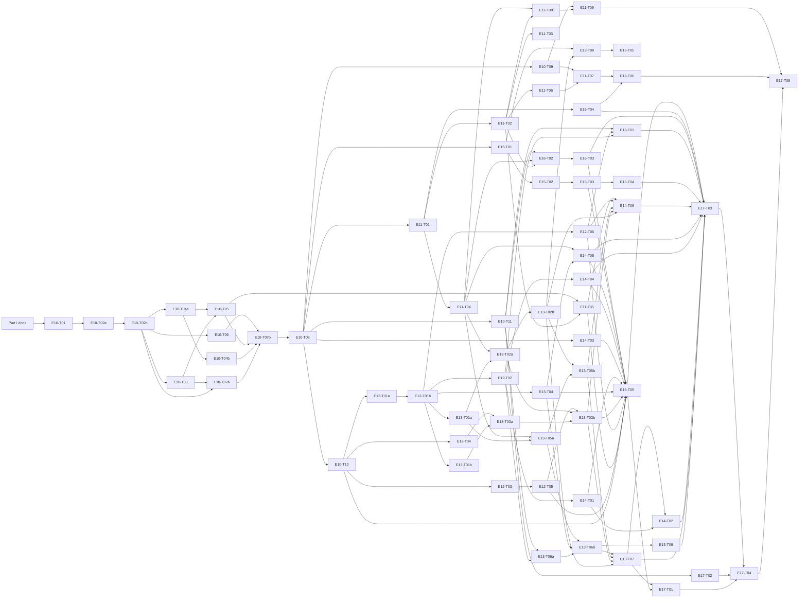

# 10 — Part II (hsmmkit + regimekit): build order, dependency graph and conventions

| Field | Value |
|---|---|
| Ticket ID | E-OV2 (meta ticket, read once, never "done") |
| Source of truth | `extensions.md` v1.2 (Part II, 2026-11-22, "Approved for ticket derivation") on top of `regimekit_concept.md` v1.1 (Part I, fully implemented in the `RegimeDetectionAndForecast` repository and released as `regimekit` 0.1.0 and 0.2.0 — 0.2.0 adds E5-T06 and E9-T01; E9-T02…T04 are spikes/ADRs). |
| Derived | 2026-11-22 |
| Ticket count | 66 implementable tickets in 8 epics (E10–E17); concept L-tickets split into a/b |
| Repositories | `RegimeDetectionAndForecast` (existing, github.com/AinoLampe/RegimeDetectionAndForecast; Python package, distribution and CLI `regimekit`; becomes the finance application) and `hsmmkit` (new; domain-neutral library, created by E10-T08) |
| Location in the repository | Tickets in `spec/tickets/` (next to the Part I tickets), concept documents in `spec/concept/`, progress in `spec/STATUS.md`, harness rules in `CLAUDE.md` |
| Predecessor | `00-OVERVIEW-build-order-and-conventions.md` (Part I) — its conventions stay in force unless this file changes them |

## 1. Purpose

Every ticket in this set is written to be implementable with **only its own file plus this overview** open. Each ticket embeds the formulas, shapes and interface signatures it needs under *Context (self-contained)*; the `Concept refs` row tells the implementer where to look if something is ambiguous (`Part II §…` = `extensions.md` v1.2, `Part I §…` = `regimekit_concept.md`). The concept documents remain authoritative: if a ticket and the concept disagree, the concept wins and the ticket is fixed.

## 2. Repositories, phases and renames

### 2.1 Repository column

Every ticket header names its repository:

| Value | Meaning |
|---|---|
| `RegimeDetectionAndForecast*` | Implemented in the `RegimeDetectionAndForecast` repository **before** the split, on core code that E10-T08 extracts into `hsmmkit` (paths `src/regimekit/<core-package>/…`), or on finance code (`src/regimekit/finance/…`). |
| `hsmmkit` | Implemented in the `hsmmkit` repository (github.com/AinoLampe/hsmmkit, paths `src/hsmmkit/…`). Exists from E10-T08 on. |
| `RegimeDetectionAndForecast` | Implemented in the `RegimeDetectionAndForecast` repository **after** the split (package `regimekit`, flattened finance package, paths `src/regimekit/…`, depends on `hsmmkit`). |

The repository name and the package name differ: `RegimeDetectionAndForecast` is the GitHub repository, `regimekit` is the Python package, distribution and CLI inside it. Only the repository is meant where a ticket says "repository"/"repo"; everything else named `regimekit` is the package.

### 2.2 Phases (Part II §15.8, D23)

1. **Decouple** (M7a, E10-T01…T07b, `RegimeDetectionAndForecast*`): introduce registries and extension points; move every finance-specific element under `regimekit/finance/`; the neutral-name allow-list (E10-T01) shrinks to empty; the `core-only` CI job proves the core runs with `regimekit.finance` blocked. **Finance golden outputs stay bitwise identical at every merge.**
2. **Extract** (M7b, E10-T08…T09): `git filter-repo` the core into `hsmmkit` with history and rename; `RegimeDetectionAndForecast` deletes its core copy, flattens `regimekit.finance.*` into `regimekit.*` and depends on `hsmmkit`.
3. **Extend** (M8–M13, E10-T10 onward): library features in `hsmmkit`; finance follow-ups in `regimekit`.

### 2.3 Rename map applied in E10-T08 (use the right-hand names in every `hsmmkit` ticket)

| `regimekit` 0.2.0 (repo `RegimeDetectionAndForecast`) | `hsmmkit` (repo `hsmmkit`) |
|---|---|
| package / distribution `regimekit` | `hsmmkit` |
| console script `regimekit` | `hsmmkit` (`regimekit` keeps its own script) |
| `RegimekitError` | `HsmmkitError` (`ConfigError, DataError, NumericalError, PersistenceError, ConstraintError` keep their names; `ProviderError` stays in `regimekit`, subclassing `hsmmkit.DataError`) |
| `REGIMEKIT_TYPECHECK`, `REGIMEKIT_RECOVERY_T` | `HSMMKIT_TYPECHECK`, `HSMMKIT_RECOVERY_T` |
| bundle dir `<name>.rkmodel/` | `<name>.hsmm/` (suffix is a `ModelStore` option; `regimekit` keeps `.rkmodel`) |
| `spec/tickets/`, `spec/concept/`, `spec/STATUS.md`, `CLAUDE.md` | carried over; `CLAUDE.md` rewritten for `hsmmkit`, `spec/STATUS.md` restarted with the `hsmmkit` tickets |
| `~/.cache/regimekit` | none in `hsmmkit` (the provider cache belongs to `regimekit`) |
| `rollvol_kmeans` | `rolling_kmeans` (renamed already in E10-T07a) |

## 3. ID scheme

- Concept ticket IDs (`E12-T03`) are preserved so traceability (Part II §17.4) holds.
- Concept tickets sized **L** are split into sub-tickets suffixed `a`, `b` (`E10-T02a`, `E10-T02b`). The sub-tickets together satisfy the parent's acceptance criteria; the parent ID is not a ticket of its own.
- Tests are named after the ticket: `tests/<layer>/test_e12_t03_*.py` in the ticket's repository. PR title = `E12-T03: <title>`. Branch = `feat/E12-T03-short-slug` in the ticket's repository.

## 4. Ticket template (all tickets use this)

```
# <ID> — <Title>
| Repo | Size | Requirements | Milestone | Concept refs |
## Goal                       one sentence
## Context (self-contained)   everything needed to implement without opening the concept
## Creates                    files / modules / tests / docs touched
## Acceptance criteria        testable, numbered
## Tests                      what the ticket's tests must cover (part of the ticket, never separate)
## Out of scope               explicit exclusions
## Connections                Depends on / Blocks / Relates to
```

## 5. Global conventions (deltas to Part I overview §4; everything not mentioned there still applies)

### 5.1 Stack
Part I stack unchanged (Python ≥ 3.13, jax ≥ 0.11 x64, equinox, optax, numpy, pandas, pyarrow, pydantic `extra="forbid"`, ruamel.yaml, typer, structlog, jaxtyping + beartype; dev tools as before). Additions, each behind an extra and an ADR: `matplotlib>=3.9` (`plot`), `scikit-learn>=1.6` (`sklearn`), `numpyro>=0.20` + `arviz>=0.21` (`bayes`; `mcmc` is a deprecated alias until 0.5.0), `xarray>=2025.1` (`xarray`). Dev-only: `copier` (scaffold), `statsmodels`, `hmmlearn`, `ruptures` (reference values). One-off tooling: `git-filter-repo` (E10-T08). `regimekit` depends on `hsmmkit` with a minor-range pin (`hsmmkit>=0.y,<0.(y+1)`) plus its Part I provider dependencies. **No new runtime dependency without an ADR.**

### 5.2 Layout
`hsmmkit` and `regimekit` trees as in Part II §15.1. Before E10-T08 the future `hsmmkit` packages live under `src/regimekit/{config,data,model,statespace,engine,estimation,inference,evaluation,persistence,cli,utils,plugins.py,testing,presets}` and finance under `src/regimekit/finance/`.

### 5.3 Dependency, layer and naming rules
1. **FR-D07 layer rule (Part I)** unchanged: `model/ statespace/ engine/ estimation/ inference/` (+ new `online/ selection/`) import from `data` only `data.contracts` and `data.batch`.
2. **FR-G08 dependency rule:** no core package imports `regimekit.finance` (pre-split) / `hsmmkit` never imports `regimekit` (post-split). The E1-T01 AST test is extended in E10-T01 and moved to `hsmmkit` in E10-T08.
3. **FR-G01 neutral-name rule:** the scanner of E10-T01 forbids finance terms in core modules (identifiers, string constants, docstrings, comments): `price`, `prices`, `returns`/`return_` as data names (not the docstring section `Returns:`), `log_return`, `symbol`, `ticker`, `trading`, `provider`, `strategy`, `sharpe`, `drawdown`, `annualiz*`, `bars_per_day`, `252`. The allow-list in `tests/fixtures/neutral_names_allowlist.txt` tags each entry with the ticket that removes it and must be empty after E10-T07b.
4. **Extension rule (D24):** extensions register components or subclass config sections; they never monkey-patch core objects or change the meaning of a core key.

### 5.4 Errors and exit codes
`HsmmkitError → ConfigError, DataError, NumericalError, PersistenceError, ConstraintError` (new, Part II §14.10). Core CLI exit codes: 0 ok · 1 unexpected · 2 config · 3 data/constraint · 4 numerical. Exit codes are a registry (`hsmmkit.cli.EXIT_CODES`); `regimekit` adds `ProviderError → 5`.

### 5.5 JAX conventions (Part I 1–8 unchanged, plus)
9. Batch dimension `B` via `jax.vmap` over per-sequence engine functions; static shapes `(T_bucket, S)`; bucket edges are static config.
10. EM E-step accumulators are reduced inside the scan; never materialize `(T, S, S)`.
11. Label and boundary masks are dynamic array inputs (`−inf/0`), not static configuration.
12. `OnlineFilter.update` is a jitted single step; fixed-lag ring buffer is a fixed-size array with a write pointer.

### 5.6 Coding standards (deltas)
Lazy imports for every extra via `hsmmkit.utils.optional_import(module, extra)`; estimators never special-case families (capability discovery through optional protocol methods returning `None`); batched code written for `B` and called with `B = 1`; deprecations via `warnings.warn(..., DeprecationWarning)` naming the removal version and listed in `docs/guide/deprecations.md`.

### 5.7 Testing
TDD mandatory additionally for: new families, `topology`, `constraints`, `batch`, `em`, `gem`, `vb`, `online`, segmentation/clustering metrics, clocks, sources, the neutral-name scanner. Every family, duration, metric, source and clock implementation is parametrized into the contract suites of `hsmmkit.testing` (from E11-T01/E10-T04a/E10-T03). Markers as in Part I plus `finance` (pre-split finance tests) and `bayes`.

**Numerical tolerances** — quote these in tests, do not invent others.

Part I Appendix D (unchanged):

| Check | Tolerance |
|---|---|
| JAX engine vs NumPy reference, loglik / posteriors | rel ≤ 1e-8 / max-abs ≤ 1e-8 |
| Posterior row normalization | ≤ 1e-10 |
| Expanded vs explicit engine on shifted-NB (`D_max` mass loss < 1e-10) | loglik rel ≤ 1e-6; smoothed max-abs ≤ 1e-6 |
| Gradient vs central finite differences (step 1e-6) | rel ≤ 1e-5 |
| Bijector log-det-Jacobian vs autodiff | ≤ 1e-8 |
| Distribution log-pdf/pmf vs scipy | ≤ 1e-10 |
| Parameter recovery (T=5000, N=3, NB r=3, 5 seeds, ≥4 pass) | σ ≤ 10 % rel; μ ≤ 2 SE; mean sojourn ≤ 25 % rel; π ≤ 0.15 abs; coefficients sign-correct, ≤ 2 SE |
| Simulation moments vs analytic | within 3 SE |
| Determinism (same config/data/seed/backend) | bitwise |
| Bundle round-trip | bitwise `u`, `loglik` |

Part II Appendix G:

| Check | Tolerance |
|---|---|
| Batched vs summed single-sequence log-likelihood | rel ≤ 1e-10 |
| Padding invariance of posteriors for `t ≤ T_b` | max-abs ≤ 1e-12 |
| Closed-form M-step vs numerical optimum of expected complete-data objective | rel ≤ 1e-8 |
| EM log-likelihood monotonicity | violations ≤ 1e-10 abs |
| EM vs MAP (no priors), same start, conjugate families | `θ` rel ≤ 1e-4; loglik rel ≤ 1e-6 |
| GEM nonparametric pmf recovery (`T = 20 000`) | TV ≤ 0.05 |
| VB posterior mean vs MAP (`T ≥ 20 000`, conjugate, flat priors) | rel ≤ 2 % |
| VB ELBO monotonicity | violations ≤ 1e-8 |
| FFBS path frequencies vs smoothed marginals | within 3 MC SE |
| MCMC (Appendix E fixture, 4 chains × 1000 draws) | means within 2 posterior SD of truth; `R̂ ≤ 1.05`; ESS ≥ 200 |
| Online vs offline filter | bitwise |
| Fixed-lag vs offline smoothing on the same prefix `y_{1:t}` | max-abs ≤ 1e-12 |
| Segmentation metrics on closed-form cases | exact |
| ARI/NMI vs scikit-learn (dev-only) | ≤ 1e-12 |
| `hmmlearn` import log-likelihood | rel ≤ 1e-8 |
| Extended recovery scenarios | as Appendix D; covariance entries ≤ 15 % rel; AR coefficients ≤ 2 SE |
| Split: `regimekit` 0.3.0 vs v0.2.0 golden values; `hsmmkit` core vs Part I golden values | bitwise |
| `gaussian` (GBM options) vs Part I GBM log-density | ≤ 1e-14 abs (bitwise where operation order is kept) |

**Golden values of v0.2.0 (baseline).** The baseline is the latest release before Part II work starts, tag `v0.2.0` (0.1.0 + E5-T06 EM + E9-T01 `ProductEmission`). E10-T01 stores the golden values of `regimekit` v0.2.0 (Appendix A pipeline on the offline fixtures: `PreparedDataset` arrays, loglik, `uparams`, smoothed posteriors, forecast samples for a fixed seed, backtest metrics) in `tests/golden/v0_2_0/` as `.npz` + JSON. Every E10 ticket and E10-T09 assert them bitwise.

### 5.8 Definition of Done (Part I §4.8 plus)
7. New implementations are registered in the appropriate contract-suite parametrization. 8. Extras stay lazily imported (import-time test passes). 9. Public protocol changes list the deprecation path (from `hsmmkit` 0.3.0). 10. `hsmmkit` changes keep the nightly `downstream` job green or come with a matching `RegimeDetectionAndForecast` ticket. 11. `RegimeDetectionAndForecast*` tickets keep the v0.2.0 golden values bitwise and do not grow the neutral-name allow-list.

### 5.9 Branching / releases
Each repository: trunk-based, short-lived branches, squash merges, conventional commits, `towncrier` fragments. Releases: `hsmmkit` 0.1.0 (E10-T08), 0.2.0 (end of M9), 0.3.0 (end of M11), 0.4.0 (end of M12), 0.5.0 (E17-T04); `regimekit` 0.3.0 (E10-T09), 0.3.0 (after E11-T07/E11-T09), 0.4.0 (E17-T05).

### 5.10 ADRs
Part II ADRs are numbered globally and stored in the repository they concern; both repositories keep 0001–0013 and **0022/0023** from the shared history. 0022 (in-scan emissions, E9-T03) and 0023 (endogenous covariates, E9-T04) already exist, so Part II uses 0014–0021 and 0024–0027 (CLAUDE.md §3.6 reserved 0014–0021 for Part II). An ADR raised during implementation that is not in this plan takes the next free number from **0028**. Plan:

| ADR | Repo | Topic | Written in |
|---|---|---|---|
| 0014 | both | Two-repository split (`RegimeDetectionAndForecast` + `hsmmkit`); decouple-then-extract (supersedes 0012) | E10-T01 (accepted in E10-T08) |
| 0015 | both | Clock registry; `trading` in `regimekit` (amends 0013) | E10-T03 |
| 0016 | hsmmkit | Registries and config extension instead of `profile` | E10-T02b |
| 0017 | hsmmkit | Entry-point plug-ins; `hsmmkit.testing` public contract | E16-T04 |
| 0018 | hsmmkit | EM/GEM/VB/MCMC as peer estimators | E13-T02a |
| 0019 | hsmmkit | Supervision as engine-level masks | E12-T06 |
| 0020 | hsmmkit | scipy runtime dependency vs vendored Hungarian | E14-T03 |
| 0021 | hsmmkit | Multi-sequence via `vmap` + length buckets | E12-T01a |
| 0024 | hsmmkit | ArviZ output, NumPyro only sampler backend | E13-T06a |
| 0025 | hsmmkit | Deprecation policy and semver scope from 0.3.0 | E17-T03 |
| 0026 | hsmmkit | Online EM algorithm choice | E13-T08 |
| 0027 | hsmmkit | HDP-HSMM go/no-go | E13-T09 |

### 5.11 Feature gates (E10-T10)
`hsmmkit` schema 1 contains every Part II §15.4 key from E10-T10 on. Keys whose implementation has not landed are rejected at model build by `hsmmkit.config.gates.check(cfg)` with `ConfigError(path, "not available before <ticket>")`. Each ticket below removes its own row from `GATES` and adds a test that the key now builds.

| Key / value | Gate removed by |
|---|---|
| `data.source.sequence_column`, `data.sequences` (B > 1) | E12-T01a (data) and E12-T02 (fit) |
| `model.initial_groups: per_group` | E12-T02 |
| `model.topology` ≠ `full` | E12-T03 |
| `model.left_censored: true` with `engine: explicit` | E12-T04 |
| `model.duration.per_state`, `model.duration.duration_dependent_jumps` | E12-T05 |
| `data.labels`, `estimation.init: labels` | E12-T06 |
| `model.emission.covariance: full` | E11-T02 |
| `model.emission.mixture` | E11-T06 |
| `estimation.method: em` / `gem` / `vb` / `mcmc` | E13-T02a / E13-T03a / E13-T05a / E13-T06a |
| `evaluation.cv` / `evaluation.grid` | E14-T01 / E14-T02 |
| `online` (`lag` / `alerts`) | E15-T01 (E15-T02 / E15-T03) |

Family, metric, init and source **names** need no gate: an unregistered name already fails with the list of registered names.

## 6. Milestones and build order

| Phase | Milestone | Tickets (in order; `‖` = parallel) | Exit criterion |
|---|---|---|---|
| 8 | M7a Decouple (`RegimeDetectionAndForecast*`) | E10-T01 → E10-T02a → E10-T02b → (E10-T03 ‖ E10-T04a ‖ E10-T06) → E10-T04b ‖ E10-T05 ‖ E10-T07a → E10-T07b | allow-list empty; `core-only` green; v0.2.0 golden bitwise |
| 9 | M7b Extract | E10-T08 → E10-T09 | `hsmmkit` 0.1.0 and `regimekit` 0.3.0 released |
| 10 | M8 Family catalogue | E10-T10 ‖ E10-T11 ‖ E11-T01 → E11-T02 → (E11-T03 ‖ E11-T05 ‖ E11-T06); E11-T04; E11-T08; `RegimeDetectionAndForecast`: E11-T07, E11-T09 | Appendix F 0.2.0 families pass the contract suite |
| 11 | M9 Sequences & structure | E12-T01a → E12-T01b → (E12-T02 ‖ E12-T06); E12-T03 → E12-T05; E12-T04 | NFR-12; topology/censoring/labels tests; tag `hsmmkit` 0.2.0 |
| 12 | M10 Estimators | E13-T01a ‖ E13-T01b ‖ E13-T04 → E13-T02a → E13-T02b; E13-T03a → E13-T03b; E13-T05a → E13-T05b; E13-T06a → E13-T06b → E13-T07; E13-T09 | parity per Appendix G |
| 13 | M11 Selection & supervision | E14-T03 (any time after E10-T08) ‖ E14-T01 → E14-T02; E14-T04; E14-T05; E14-T06 | grid/CV tables; tag `hsmmkit` 0.3.0 |
| 14 | M12 Online & interop | E15-T01 → E15-T02 → E15-T03 → E15-T04 (may start right after E10-T08); E13-T08 → E15-T05; E16-T01 ‖ E16-T02 → E16-T03; E16-T04 → E16-T06 (`RegimeDetectionAndForecast`); E16-T05 (last: needs E13-T04, E14-T01/T03/T04/T05, E15-T03, E16-T03) | tag `hsmmkit` 0.4.0 |
| 15 | M13 General release | E17-T02 ‖ E17-T01 → E17-T03 → E17-T04 → E17-T05 (`RegimeDetectionAndForecast`) | `hsmmkit` 0.5.0, `regimekit` 0.5.0 |

**Critical path:** E10-T01 → E10-T02a → E10-T02b → E10-T03 → E10-T05 → E10-T07b → E10-T08 → E10-T10 → E12-T01a → E12-T01b → E13-T01a → E13-T02a → E13-T02b → E13-T05b → E13-T07 → E14-T02 → E17-T03 → E17-T04 → E17-T05.

## 7. Dependency graph



## 8. Ticket index

| ID | Repo | Title | Size | File |
|---|---|---|---|---|
| E10-T01 | RegimeDetectionAndForecast* | Split guardrails: neutral-name scanner, `core-only` job, v0.2.0 golden values, ADR-0014 | S | `E10-T01-split-guardrails.md` |
| E10-T02a | RegimeDetectionAndForecast* | Component registries | M | `E10-T02a-component-registries.md` |
| E10-T02b | RegimeDetectionAndForecast* | Config extension, `FinanceConfig`, schema v2 migration, ADR-0016 | M | `E10-T02b-config-extension-schema-v2.md` |
| E10-T03 | RegimeDetectionAndForecast* | Clock registry; `trading` to finance; ADR-0015 | M | `E10-T03-clock-registry.md` |
| E10-T04a | RegimeDetectionAndForecast* | Generic `ObservationSet`, `Source` protocol, numpy/pandas/csv/parquet sources, `source_contract` | M | `E10-T04a-generic-sources.md` |
| E10-T04b | RegimeDetectionAndForecast* | xarray source; providers as source kind `provider`; cache moved to finance | M | `E10-T04b-provider-source-cache-move.md` |
| E10-T05 | RegimeDetectionAndForecast* | Generic `Preparer`, observation transforms, supports, quality split | M | `E10-T05-generic-preparer-supports.md` |
| E10-T06 | RegimeDetectionAndForecast* | Core `gaussian` (diag) emission; `gbm` alias | M | `E10-T06-core-gaussian-gbm-alias.md` |
| E10-T07a | RegimeDetectionAndForecast* | Neutral init, walk-forward origin hooks, strategies to finance, bundle v2 | M | `E10-T07a-neutral-estimation-evaluation-bundle.md` |
| E10-T07b | RegimeDetectionAndForecast* | CLI app factory, `Project`/`FinanceProject`; allow-list empty | M | `E10-T07b-cli-project-split.md` |
| E10-T08 | hsmmkit | Extract `hsmmkit` repository; release 0.1.0 | M | `E10-T08-extract-hsmmkit.md` |
| E10-T09 | RegimeDetectionAndForecast | `regimekit` on top of `hsmmkit`; release 0.2.0 | M | `E10-T09-regimekit-on-hsmmkit.md` |
| E10-T10 | hsmmkit | Complete schema with feature gates; JSON Schema; presets registry | M | `E10-T10-core-schema-presets.md` |
| E10-T11 | hsmmkit | Lazy optional imports, extras, import-time test | S | `E10-T11-optional-imports-extras.md` |
| E11-T01 | hsmmkit | `family_contract` suite | M | `E11-T01-family-contract.md` |
| E11-T02 | hsmmkit | Gaussian full covariance | M | `E11-T02-gaussian-full-covariance.md` |
| E11-T03 | hsmmkit | Multivariate Student-t | S | `E11-T03-mv-student-t.md` |
| E11-T04 | hsmmkit | Poisson, Bernoulli, Categorical | M | `E11-T04-poisson-bernoulli-categorical.md` |
| E11-T05 | hsmmkit | MS-AR(p) | M | `E11-T05-msar.md` |
| E11-T06 | hsmmkit | Per-state finite mixture | M | `E11-T06-mixture.md` |
| E11-T07 | RegimeDetectionAndForecast | OU and Merton jump-diffusion | M | `E11-T07-ou-merton.md` |
| E11-T08 | hsmmkit | Joint/product emission composition | M | `E11-T08-product-composition.md` |
| E11-T09 | RegimeDetectionAndForecast | Correlated multi-primary finance configuration | S | `E11-T09-correlated-multi-primary.md` |
| E12-T01a | hsmmkit | `SequenceBatch`, padding, buckets; ADR-0021 | M | `E12-T01a-sequence-batch-padding.md` |
| E12-T01b | hsmmkit | Batched engines and unpadding | M | `E12-T01b-batched-engines.md` |
| E12-T02 | hsmmkit | Batch MAP, per-group initial distributions, batched simulate | M | `E12-T02-batch-map-groups.md` |
| E12-T03 | hsmmkit | Transition topology and absorbing states | M | `E12-T03-topology.md` |
| E12-T04 | hsmmkit | Left-censoring in the explicit engine | S | `E12-T04-left-censoring.md` |
| E12-T05 | hsmmkit | Per-state durations, duration-dependent jumps | M | `E12-T05-per-state-durations-dd-jumps.md` |
| E12-T06 | hsmmkit | Label/boundary constraints, label init; ADR-0019 | M | `E12-T06-constraints-labels.md` |
| E13-T01a | hsmmkit | Expanded-engine E-step accumulators | M | `E13-T01a-expanded-estep-accumulators.md` |
| E13-T01b | hsmmkit | Explicit-engine segment posteriors `η` | M | `E13-T01b-explicit-segment-posteriors.md` |
| E13-T02a | hsmmkit | `EMEstimator`: closed-form M-steps; ADR-0018 | M | `E13-T02a-em-closed-form.md` |
| E13-T02b | hsmmkit | ECM, tempering, restarts, parity | M | `E13-T02b-ecm-tempering.md` |
| E13-T03a | hsmmkit | GEM: jumps, nonparametric durations, censoring | M | `E13-T03a-gem-jumps-nonparametric.md` |
| E13-T03b | hsmmkit | GEM: parametric durations, emissions, parity | M | `E13-T03b-gem-parametric-durations.md` |
| E13-T04 | hsmmkit | FFBS (both engines) | M | `E13-T04-ffbs.md` |
| E13-T05a | hsmmkit | VB: conjugate updates, structured `q(s)`, ELBO | M | `E13-T05a-vb-conjugate-elbo.md` |
| E13-T05b | hsmmkit | VB: pruning, VB-EM hybrid, parity | M | `E13-T05b-vb-pruning-hybrid.md` |
| E13-T06a | hsmmkit | MCMC: NUTS, `bayes` extra, ArviZ; ADR-0024 | M | `E13-T06a-mcmc-nuts.md` |
| E13-T06b | hsmmkit | MCMC: blocked Gibbs, relabelling, agreement | M | `E13-T06b-gibbs-relabel.md` |
| E13-T07 | hsmmkit | Estimator parity suite, docs, `compare --estimators` | M | `E13-T07-estimator-parity-docs.md` |
| E13-T08 | hsmmkit | Online EM spike; ADR-0026 | S | `E13-T08-online-em-spike.md` |
| E13-T09 | hsmmkit | HDP-HSMM spike; ADR-0027 | S | `E13-T09-hdp-hsmm-spike.md` |
| E14-T01 | hsmmkit | `Splitter` interface, `SequenceKFold`, walk-forward re-base | M | `E14-T01-splitters.md` |
| E14-T02 | hsmmkit | Grid model selection | M | `E14-T02-grid-selection.md` |
| E14-T03 | hsmmkit | Segmentation and clustering metrics; ADR-0020 | M | `E14-T03-segmentation-clustering-metrics.md` |
| E14-T04 | hsmmkit | Parametric bootstrap | M | `E14-T04-parametric-bootstrap.md` |
| E14-T05 | hsmmkit | Pseudo-residuals, posterior predictive checks | M | `E14-T05-pseudo-residuals-ppc.md` |
| E14-T06 | hsmmkit | Extended recovery scenarios, `hsmmkit selftest` | M | `E14-T06-extended-recovery-selftest.md` |
| E15-T01 | hsmmkit | `OnlineFilter` | M | `E15-T01-online-filter.md` |
| E15-T02 | hsmmkit | Fixed-lag smoothing | M | `E15-T02-fixed-lag-smoothing.md` |
| E15-T03 | hsmmkit | Alerts and online forecast | S | `E15-T03-alerts-online-forecast.md` |
| E15-T04 | hsmmkit | `hsmmkit stream` CLI, `Project.online()` | S | `E15-T04-stream-cli.md` |
| E15-T05 | hsmmkit | (v1.x) Online EM | M | `E15-T05-online-em.md` |
| E16-T01 | hsmmkit | scikit-learn wrapper | M | `E16-T01-sklearn-wrapper.md` |
| E16-T02 | hsmmkit | pandas/xarray conversion, `hmmlearn` import | M | `E16-T02-pandas-xarray-hmmlearn.md` |
| E16-T03 | hsmmkit | Plotting | M | `E16-T03-plotting.md` |
| E16-T04 | hsmmkit | Entry points, scaffold, `plugin` CI; ADR-0017 | M | `E16-T04-entry-points-scaffold.md` |
| E16-T05 | hsmmkit | Presets completion, core tutorials | M | `E16-T05-presets-tutorials.md` |
| E16-T06 | RegimeDetectionAndForecast | `regimekit` as entry-point plug-in, finance presets | S | `E16-T06-regimekit-plugin.md` |
| E17-T01 | hsmmkit | Documentation restructure | M | `E17-T01-docs-restructure.md` |
| E17-T02 | hsmmkit | PyPI + conda-forge distribution | S | `E17-T02-distribution.md` |
| E17-T03 | hsmmkit | ADRs accepted, deprecation policy, benchmarks; ADR-0025 | S | `E17-T03-adrs-benchmarks.md` |
| E17-T04 | hsmmkit | Release `hsmmkit` 0.5.0 | S | `E17-T04-release-0-5-0.md` |
| E17-T05 | RegimeDetectionAndForecast | Finance docs and release `regimekit` 0.5.0 | S | `E17-T05-regimekit-docs-release.md` |

## 9. Relationship to implemented Part I tickets

| Part I ticket / artefact | Part II follow-up |
|---|---|
| E1-T01 `PreparedDataset` (amended), AST layer/profile test | E10-T01 extends the AST test (dependency + neutral names); `clock` becomes a registered string in E10-T03 |
| E1-T02a/b config, `profile` key, migration hook | E10-T02b (`FinanceConfig`, schema v2, `profile` dropped); E10-T10 (complete `hsmmkit` schema) |
| E2-T01 provider protocol + contract suite | E10-T04a (`source_contract`), E10-T04b (providers become source kind `provider`) |
| E2-T05 cache, E2-T08 quality report | E10-T04b (cache to finance), E10-T05 (quality split) |
| E2-T06 calendar / clocks | E10-T03 |
| E2-T07 `Preparer` | E10-T05 |
| E3-T01 GBM, E3-T02 Student-t | E10-T06 (`gaussian`, `gbm` alias, `student_t` explicit `scale_by_dt`), E11-T03 |
| E5-T03 `rollvol_kmeans` | E10-T07a (`rolling_kmeans`) |
| E5-T06 EM for GBM | superseded by E13-T02a (its tests kept as regression) |
| E7-T01 `balanced_accuracy` (brute-force matching) | E14-T03 (Hungarian) |
| E7-T02a/b walk-forward, E7-T03 strategies | E10-T07a (origin hooks; strategies to finance), E14-T01 (`Splitter`) |
| E8-T01 bundle | E10-T07a (bundle v2), E10-T09 (v1 compatibility) |
| E8-T02 `Project`/CLI | E10-T07b |
| E9-T01 `ProductEmission` | E11-T08 |
| E9-T02 factorial prototype, ADR-0008 | moves to `hsmmkit` unchanged (experimental) |
| E9-T03 MS-GARCH spike | moves to `regimekit.emission.msgarch` in E10-T09 |
| E9-T04 endogenous covariates ADR | unchanged (both repositories keep it) |

## 10. Guardrails

- During M7a nothing gains new behaviour: every `RegimeDetectionAndForecast*` ticket is a move/rename/extension-point refactor, proven by the v0.2.0 golden values.
- No Part II feature (batches, new families, estimators) is implemented before E10-T08; if it is tempting while refactoring, it belongs to E11–E16.
- `hsmmkit` tickets never touch `RegimeDetectionAndForecast`; when an `hsmmkit` change requires a `regimekit` adaptation, the `RegimeDetectionAndForecast` ticket is named under *Connections* and the `downstream` job is the gate.
